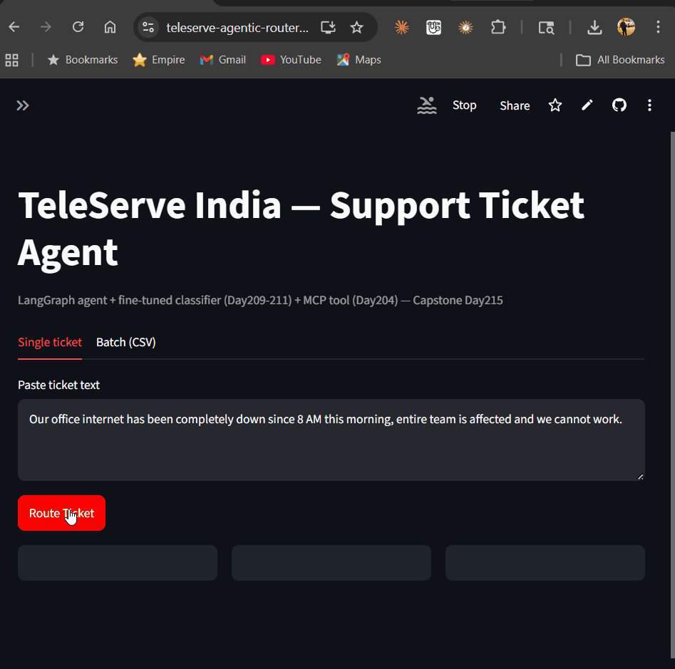

# TeleServe Agentic Router

**A LangGraph-based support-ticket triage agent** that classifies incoming tickets with a fine-tuned DistilBERT (LoRA) model, checks a live MCP knowledge-base tool for edge cases, and routes each ticket to auto-resolution or human review — with a persistent-connection fix that cut per-call latency by ~208x.

[](https://www.python.org/)
[](https://streamlit.io/)
[](https://github.com/langchain-ai/langgraph)
[](LICENSE)
**[Live Demo → teleserve-agentic-router.streamlit.app](https://teleserve-agentic-router-tmwo3kyftn9ix8mdgaqk64.streamlit.app)** 



---

## Why this exists

Most "chatbot" portfolio projects retrieve an answer and stop. This one makes a **decision under uncertainty**: it classifies a ticket, checks its own confidence, calls an external tool only when the ticket needs it, and hands off to a human when confidence drops below threshold — the same shape as a real support-routing system a company would actually deploy.

## Architecture

```
                 ┌─────────────────┐
   ticket text → │  classify_node   │  (LoRA-merged DistilBERT, CPU inference)
                 └────────┬─────────┘
                          │ priority + confidence
                 ┌────────▼─────────┐
                 │ routing_decision  │  (confidence ≥ 0.60 ?)
                 └────┬────────┬────┘
             auto_route      human_review
                 │                │
        ┌────────▼────────┐      │
        │ mcp_lookup_node  │      │
        │ (persistent MCP  │      │
        │  client, ~68ms)  │      │
        └────────┬────────┘      │
                 └───────┬────────┘
                       END
```

- **Classifier:** DistilBERT + LoRA (PEFT), merged to full precision (`merge_and_unload`) for CPU-only inference — no `bitsandbytes`/GPU dependency, so it runs on Streamlit Community Cloud and on a laptop with no discrete GPU.
- **Orchestration:** LangGraph `StateGraph` with a conditional edge on `routing_decision`.
- **Tool layer:** a custom MCP server (FastMCP) queried through a **persistent `MCPClientManager`** — a background asyncio thread holding one long-lived `StdioTransport` subprocess, reused across every call instead of respawned per call.
- **UI:** Streamlit, single-ticket + batch CSV tabs, live display of priority / confidence / routing decision / MCP signal.

## The bug that made this a real project, not a toy demo

Early integration testing showed `auto_route` tickets consistently taking ~3.8–4.0s while `human_review` tickets returned in ~20ms. The `human_review` path skips the MCP tool entirely — so the slowdown had to be in `mcp_lookup_node`. Root cause: it was spawning a **brand-new subprocess** on every single call. Fix: a singleton `MCPClientManager`, initialized once at app start via `st.cache_resource`, holding one persistent connection for the app's lifetime.

**Measured result on an 18-ticket batch, real model + real MCP subprocess (not mocked):**

| | Before (per-call spawn) | After (persistent client) |
|---|---|---|
| Cold start (model load + subprocess spawn) | — | 14,242 ms (one-time) |
| Per-call latency (warm) | ~3,800–4,000 ms | **68.4 ms avg** (range 48.7–98.5 ms) |
| Improvement | — | **~208x** |

## Known limitation (not a bug)

On unseen phrasing, the classifier misroutes some ambiguous outage-style tickets to P2 instead of P1. The confidence-threshold gate catches these correctly — 2 of 3 such tickets were routed to `human_review` rather than auto-routed incorrectly. This is a model-accuracy ceiling, not a system defect, and it's exactly the failure mode the human-review lane exists to catch.

## Tech stack

`langgraph` `langchain-groq` `fastmcp` `peft` `transformers` `streamlit` `pandas` `scikit-learn`

## Quickstart

```bash
git clone https://github.com/deepanshu0110/teleserve-agentic-router.git
cd teleserve-agentic-router
pip install -r requirements.txt
streamlit run app.py
```

Requires a free [Groq API key](https://console.groq.com) set as `GROQ_API_KEY`.

## Project structure

```
teleserve-agentic-router/
├── app.py                  # Streamlit UI (single-ticket + batch tabs)
├── graph_logic.py          # LangGraph StateGraph + MCPClientManager
├── mcp_server.py           # FastMCP tool server (Day 204)
├── model/                  # merged full-precision DistilBERT (Day 209/215)
├── data/sample_tickets.csv # test batch, matches training schema
├── docs/
│   ├── demo.gif
│   └── architecture.png
└── requirements.txt
```

## Roadmap

- [ ] Swap Groq for a local Ollama model (offline fallback)
- [ ] Add a vector-DB lookup node (Pinecone/Qdrant) alongside the MCP tool
- [ ] Multi-agent handoff via CrewAI for tickets requiring billing + technical review

---

Built as part of a structured 13-month applied AI/ML program. Related repos: [ResumeGapAI](https://resumegapai.streamlit.app) (live) · [Month12-Capstone-Portfolio](#).